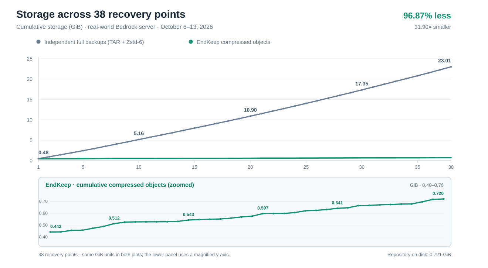

# Storage benchmark: 38 recovery points

A live Minecraft Bedrock server retained **38 recovery points** (1 BASE and 37 DELTAs) over **156.2 hours**, from October 6–13, 2026.

| Storage for all 38 recovery points | Size |
| --- | ---: |
| Independent full backups (TAR + Zstd-6) | **23.009 GiB** |
| **EndKeep repository (on disk)** | **0.721 GiB** |

**96.87% less storage** than independently compressed Zstd-6 full backups (**31.90× smaller**).

<picture>
  <source media="(prefers-color-scheme: dark)" srcset="cumulative-storage-dark.svg">
  <source media="(prefers-color-scheme: light)" srcset="cumulative-storage.svg">
  
</picture>

The main chart compares the cumulative sizes of independent full backups and EndKeep compressed objects, both in **GiB**. The lower panel magnifies EndKeep's compressed-object growth. The repository total in the table additionally includes filesystem allocation and repository metadata.

## Method

All 38 recovery points were restored independently into fresh LevelDB worlds, verified by the restore tool, and measured one at a time. Each world was separately compressed using:

```sh
tar -C "$world" -cf - . | zstd -T1 -6 -q -c | wc -c
```

The restored world was removed before processing the next recovery point. The repository occupied **774,377,472 bytes** as measured with `du -s -B1 backups/repo` for the 38-point manifest (generation 44).

[Per-snapshot measurements (CSV)](snapshots.csv) include the independent compression results, snapshot metadata, and cumulative uniquely referenced compressed objects. The reported repository size is the actual on-disk size, not just the sum of compressed objects.

This is a **storage** benchmark from one real server. It does not measure backup or restore speed, and it does not compare EndKeep with other cross-snapshot deduplicating tools.

